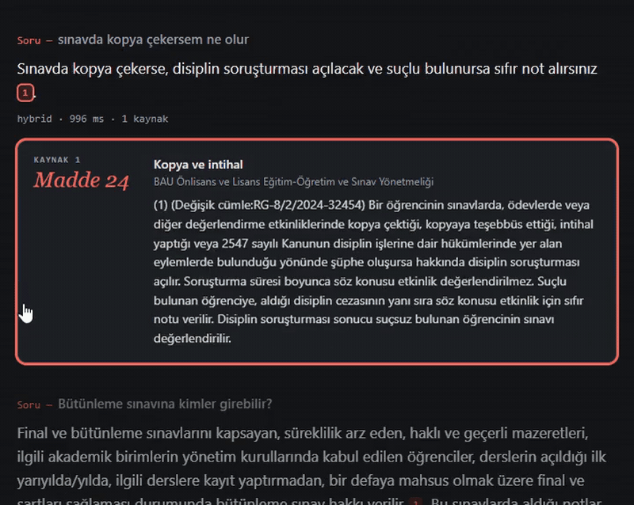

# bau-mevzuat-rag


Ask a question about the Turkish Constitution or Bahçeşehir University's regulations and get an answer that
points at the exact article it came from. Runs entirely on my laptop. No API keys, no cloud.



I built this because I kept getting the same questions from friends ("can I freeze my registration?",
"what happens if I miss the final?") and the answers are all in two long documents nobody reads. It's also
the second project in a series where I'm working through the LLM stack one layer at a time. This one is
the retrieval layer. I wanted to actually understand chunking, hybrid search and evaluation rather than call
a framework, so there's no LangChain here; every step is a short file I wrote and can explain.

**Stack:** Python 3.12 · FastAPI · Ollama (`gemma4:12b` for answers, `bge-m3` for embeddings) · Qdrant ·
rank-bm25 · `bge-reranker-v2-m3` (optional) · pytest · Docker

## Running it

```bash
ollama pull bge-m3 && ollama pull gemma4:12b                      # https://ollama.com, about 9 GB
python -m venv .venv && .venv/Scripts/pip install -e ".[dev]"   # Linux/mac: .venv/bin/pip
python -m app.ingest                                              # data/raw/* -> chunks + Qdrant
uvicorn app.api:app --reload                                      # http://localhost:8000
```

The default model wants about 12 GB of GPU or unified memory. With `ANSWER_MODEL=qwen2.5:7b` it fits in 8 GB and
answers about 8x faster, but it gets far more wrong (numbers below). It works on CPU too, just slower. Models
can be swapped through `.env` (see `.env.example`); any Ollama chat/embedding model works.

The `rerank` mode needs a cross-encoder, which Ollama doesn't serve: `pip install -e ".[rerank]"` pulls
sentence-transformers + torch, and `BAAI/bge-reranker-v2-m3` (~1 GB) downloads on first use. Everything
else works without it.

`data/raw/` holds the raw HTML from [mevzuat.gov.tr](https://www.mevzuat.gov.tr): the Constitution (law no. 2709)
and the two BAU regulations (nos. 33950 and 42316). Drop any other `.pdf`, `.docx`, `.html` or `.txt` in there and re-run ingest; the
file name becomes the document title in citations.

### API

```
POST /ask   {"question": "...", "mode": "hybrid" | "dense" | "bm25" | "rerank", "k": 6}
        ->  {"answer": "... [1] ...", "citations": [{doc_title, article_no, heading, text}], "mode", "latency_ms"}
GET  /health
GET  /       the chat page
```

### Docker

```bash
docker compose up -d                                   # app + Qdrant; Ollama stays on the host
docker compose run --rm app python -m app.ingest
```

Qdrant's embedded mode (the default) only allows one process at a time, so you can't run the API and the
eval together. Compose runs Qdrant as a proper server and removes that limit.

## How it works

```
data/raw/*  ──ingest──►  article chunks ("MADDE n")  ──embed──►  Qdrant
                                                    └──────────►  BM25 (in-process)

question ──► dense top-10 ─┐
         └─► BM25  top-10 ─┴─► RRF fusion ─► top-6 ─► quote, then answer ─► answer check ─► answer + [n] citations
                            └─► cross-encoder rerank ─► top-6   (optional "rerank" mode)       └─► or "not found"
```

**Chunking.** Turkish legislation is written as `MADDE 5 – (1) ... (2) ...`, so one article is one chunk.
That's the natural unit of meaning and the natural unit to cite. `Geçici Madde` / `Ek Madde` are articles
too, with their own ids. Articles over 600 words get split at paragraph `(n)` boundaries, or at line breaks
when a document doesn't number its paragraphs; anything without article structure falls back to 400-word
windows with overlap. The amending-law appendix mevzuat.gov.tr attaches after the last article is dropped.

**Retrieval.** Three modes so I could compare them: dense (bge-m3, 1024-d, in Qdrant), BM25 over 5-character
prefixes (a cheap Turkish stemmer: `sınavlara`, `sınavın`, `sınav` all become `sınav`), and hybrid, which
fuses the two with Reciprocal Rank Fusion. Hybrid is the default, with one rule on top of plain RRF: each
retriever's #1 result is guaranteed a slot in the top-k. I added that after "onur öğrencisi" (honour student):
BM25 put the one article containing "onur" at rank 1, dense didn't have it in its top 10 at all, and RRF
averaged it out to rank 7, so the model never saw it and confidently invented a GPA threshold. With the
rule it's in the top 5 and the model correctly says the regulation doesn't specify one.

**Reranking.** A fourth mode: take the top 10 from each retriever (up to 20 candidates) and let
`bge-reranker-v2-m3`, a cross-encoder, score each (question, article) pair jointly. Unlike the bi-encoder
it reads both texts at once, so it can tell "the article about X" from "an article that mentions X".
~220 ms on the GPU in fp16 with 512-token pairs; it was 1.4 s at fp32 / 1024 tokens / 40 candidates before
I trimmed it.

**Grounding.** The model only sees the six retrieved articles. It first copies the sentences that answer the
question word for word (`ALINTI`), then writes a short answer from them (`CEVAP`) with a `[n]` on each claim;
only the answer is shown. Quoting first is what stopped it from misreading numbers in articles it had right in
front of it. A second, one-word call then checks the finished answer: does it actually say something, or only
"the regulation doesn't specify, the Rektörlük announces it"? The second kind becomes exactly
`Bu konuda mevzuatta bilgi bulamadım.` The code makes that decision from the model's one word, not the model
by following a "say not found" instruction, which it ignored (details under the hard test set). Citation
markers that don't map to a retrieved chunk get stripped, and the rest are renumbered so the answer and the
citation list always agree. If retrieval comes back empty, the model isn't called at all.

**Guardrails.** Question length 3 to 500 chars, `k ≤ 10`, retry with backoff on 5xx/connection errors, 503
instead of a stack trace when the backend is down.

**Latency.** About 8 s per question on an RTX 4090 laptop with `gemma4:12b`: a bigger model, a quote before
every answer, and a second call to check it. With `qwen2.5:7b` and the old one-step prompt it was about 1 s,
and I'm keeping the story of how it got there, because the 1 s was hard-won and the 8 s is a choice: the hard
test set went from 11/20 to 19/20. My first version took 9.7 s and I assumed that was just local inference. Measuring showed otherwise: every Ollama
call had a fixed ~2 s cost, and it turned out to be `localhost` resolving to `::1` first on Windows while
Ollama only listens on IPv4. Two calls per question, four seconds of nothing. `127.0.0.1` fixed it. The
other half was the model writing 400-token essays; capping the prompt at "3-4 sentences" brought generation
to ~50 tokens. Both were invisible until I timed each stage separately. A side effect I didn't expect: the
shorter answers also scored higher on faithfulness (0.933 → 0.967). Less room to drift from the source.

## Evaluation

I didn't want to ship a chatbot that "seems fine", so there's an eval harness:

```bash
python -m eval.make_questions      # drafts 40 Q/A pairs from random articles -> eval/questions.draft.jsonl
# I review these by hand and keep the good ones -> eval/questions.jsonl
python -m eval.run_eval --no-judge # retrieval metrics only
python -m eval.run_eval            # + LLM-judged faithfulness / correctness
python -m eval.run_eval --phase judge --answers eval/results/<date>-answers.jsonl   # re-grade saved answers
python -m eval.run_eval --questions eval/questions_hard.jsonl      # the hard set below
python -m eval.run_eval --questions eval/questions_holdout.jsonl   # questions nothing was tuned on
python -m eval.check_judge --model gemma4:12b                      # how far to trust the judge
```

The eval runs in two phases so only one LLM sits in VRAM at a time. Phase 1 retrieves and writes every
answer to `eval/results/<date>-answers.jsonl`, then unloads the answer model; phase 2 reads that file and
grades it with the judge. My first version interleaved them (answer, judge, answer, judge...), which keeps
both models loaded for the whole run. Two 7B models fit in 16 GB; a larger answer model next to the judge
would not, and Ollama would spill layers to the CPU. Splitting the phases also means a change to the judge
prompt only needs phase 2 (15 s for 40 answers instead of the full 90 s), and `--model` swaps the answer
model without touching the judge.

Retrieval by mode on the first test set (no LLM involved, so these numbers need no judge):

| mode | Recall@5 | MRR |
|---|---|---|
| dense | 1.000 | 0.839 |
| bm25 | 0.967 | 0.801 |
| hybrid | 1.000 | 0.861 |
| rerank | 1.000 | **0.894** |

_30 human-reviewed answerable questions plus 10 unanswerable ones, over 302 article chunks (Constitution +
two BAU regulations), `bge-m3` embeddings. This table used to have LLM-judged answer columns too; I took them
out when I found the judge was grading far too kindly (see "Grading the grader" below). Answer quality for the
current system is in the tables further down. Raw numbers per run go to `eval/results/` (not committed)._

The same 30 questions, before and after adding the Constitution (100 → 302 chunks):

| mode | MRR @100 | MRR @302 |
|---|---|---|
| dense | **0.864** | 0.839 |
| bm25 | 0.756 | 0.801 |
| hybrid | 0.861 | **0.861** |

Tripling the corpus with off-topic articles hurt dense (more plausible-looking distractors), *helped* BM25
(IDF sharpened: BAU-specific terms became rarer relative to the whole corpus), and left hybrid exactly where
it was. On a tiny corpus dense alone was enough; the moment the corpus grew, hybrid pulled ahead. That is
the whole argument for hybrid search in one table.

- **Recall@5 / MRR**: is the article the question was written from in the top 5, and how high up.
- **Faithfulness**: every claim in the answer is backed by a cited article (LLM judge, yes/no).
- **Correctness**: the answer gives the same core answer as the reference I checked by hand (LLM judge,
  calibrated against my own grading, see below).
- **Abstention**: on questions the corpus cannot answer (cafeteria prices, dorm deadlines, "how many months is
  military service"), did the system say `bilgi bulamadım` instead of making something up. No judge needed;
  it's an exact-string check.

What I take from the table: reranking is the best ranking (0.894). BM25 alone still misses a paraphrased
question with no shared stem, so dense, hybrid and rerank win on recall.
Hybrid stays the default because it needs nothing beyond Ollama; switch to `rerank` when the extra
dependency is acceptable. Hybrid has dense's recall, stays robust on exact-term queries (article numbers,
grade letters) where BM25 is strongest, and (see above) is the only base mode that didn't lose ground
when the corpus grew.

**The one abstention failure is the most interesting row in the table.** All three modes fail the same
question: "what GPA do I need to be an honour student?" The regulation only says the Senate sets the rule
(Madde 34), no number. With 100 chunks my top-hit guarantee got Madde 34 in front of the model and it
correctly abstained. With 302 chunks a graduate-school article full of "not ortalaması" outranks Madde 34
in BM25, the guarantee carries the wrong article, and the model reads the 2.00 threshold from the
*neighbouring* article on academic standing and confidently applies it to honours. That's the hardest kind
of hallucination, a plausible number from an adjacent rule, and a rank-fusion trick can't fix it
reliably.

I expected the reranker to fix it. It didn't: the cross-encoder also ranks the GPA articles above Madde 34,
because the question *asks for a number* and Madde 34 has none. Every ranker is answering "which article
best matches this question", and for a question whose correct answer is "the rule doesn't specify", the
best-matching article is the wrong one. Reranking still moved overall MRR from 0.861 to 0.894, so it earns
its place as the best mode. But this particular failure needs the *generator* to be more suspicious, not the
retriever to be smarter. That turned out to be right: the answer check described below fixed it, and the
system now says the regulation doesn't give a number.

**Two honest caveats.** The questions are generated *from* their target article, so they share its
vocabulary, which flatters retrieval: Recall@5 saturating on a 100-chunk corpus says more about the test
set than the system. MRR is the number I actually watch. And 30 questions is small; answer scores move by
a question or two between runs even at temperature 0.

The most useful thing the eval did was catch chunking bugs. The regulations come as Word-exported HTML that
wraps lines *inside* `<span>`s, so a naive HTML-to-text split headings like "Dersten çekilme" over two lines
and leaked the next article's heading into the previous chunk. Section headers ("BEŞİNCİ BÖLÜM …") leaked the
same way. Each cleanup moved dense MRR: 0.825 → 0.847 → 0.864. Chunk quality *is* retrieval quality.

Adding the Constitution surfaced three more, all in one afternoon: it has 24 `Geçici Madde n` (transitional
articles) that the `MADDE n` regex silently folded into article 177; mevzuat.gov.tr appends the full text of
every amending law after the last article, so their own "Madde 4", "Madde 16" collided with the real ones
(the appendix is now cut at the "KANUNA İŞLENEMEYEN HÜKÜMLER" marker); and the Constitution doesn't number
its paragraphs `(1) (2)`, so the long-article splitter had nothing to split on and produced a 3,400-word
chunk (it now falls back to line breaks). Every new document type breaks the chunker somewhere.


### A harder test set

The easy set was saturating, so I made a second one designed to break things: 20 questions
(`eval/questions_hard.jsonl`), drafted with an AI assistant and checked against the article text. They are
not real student questions, but each one targets something the easy set couldn't test:

- **paraphrase (8):** everyday words instead of the article's terms. "Okulu tamamen bırakmak istiyorum" has
  to find the article that only ever says "kayıt sildirme".
- **multi (6):** the answer needs two paragraphs or two articles combined, like "I'm a fourth-year with a
  2.10 GPA, can I take more credits than my limit to graduate?"
- **constitution (3):** the Constitution in plain language ("how long can the police hold me?").
- **trap (3):** questions that sound answerable but aren't in the documents (Erasmus GPA, exam dates).

### Grading the grader

The first run on the hard set said 15/20. I didn't believe it, so I graded all 34 answers by hand. The 7B
judge had passed 8 answers that were wrong: a wrong number of courses, "three semesters" instead of two, a
flipped yes/no. The real score was 11/20, and the easy set's 0.93 correctness was inflated the same way.
Every number I had published for answer quality was measuring the judge's kindness.

Two changes made the judge trustworthy. It no longer gives a verdict; it reports three facts (same core answer
as the reference? anything contradicting it? any claim not in the sources?) and the code computes the verdict.
Asked for a verdict directly, a model would reason "the core answer is right and nothing contradicts it" and
then write "wrong" anyway because a detail was missing. And the judge is now chosen by measurement:
`eval/judge_labels.jsonl` holds 51 answers I graded by hand, and `python -m eval.check_judge` runs any model
against them.

| judge | agrees with my grading | passed a wrong answer | failed a right one |
|---|---|---|---|
| qwen3.5:9b | 48/51 | 1 | 2 |
| **gemma4:12b** | **48/51** | **0** | 3 |

`gemma4:12b` is also the answer model, so it could be soft on its own answers. On the 17 of its answers in the
calibration set it agreed with me every time, and all of its misses go the strict way, so the scores below
are if anything slightly low.

### From 11/20 to 19/20

Everything graded by the same judge:

| system | hard (20) | easy (40) | held out (12) |
|---|---|---|---|
| where I started: `qwen2.5:7b`, answers straight from 5 articles | 11 | 33 | |
| `gemma4:12b`, quote then answer, 6 articles | 16 | | |
| + a "do the articles answer this?" field before answering | 16 | **37** | 12 |
| + checking the finished answer instead (current) | **19** | 35 | **12** |

On the hard set the current version gets paraphrase 8/8, multi-article 5/6, Constitution 3/3 and traps 3/3.
What each step did:

- **A stronger model did most of the work.** `qwen2.5:7b` misread Turkish legal sentences with the right
  article in front of it. Asked whether freezing registration for illness costs money, it answered "you pay
  25%"; the article says illness is exempt and the 25% is for other reasons. No prompt fixed that.
  `gemma4:12b` reads it correctly. I also tried `qwen3.5:9b`: it answered 9 of 17 and fell for every trap.
- **Quote, then answer.** Copying the relevant sentences first keeps numbers and durations straight. The
  instructions also had to move *below* the articles: with them on top, the 7B model had forgotten them
  5,000 tokens later and never wrote the quote at all.
- **Six articles instead of five.** Three misses had the right article at rank 6. Measuring this also
  exposed a bug in my eval: it sliced the top 5 out of a top-10 search, while the API searches for 5 directly,
  and hybrid's "each retriever's #1 gets a seat" rule gives that seat to the *last* slot of whatever k you ask
  for. The eval could answer from different articles than the API. It now searches exactly like the API.
- **Traps: telling didn't work, checking did.** Told to write "not found" when the articles don't answer,
  gemma wrote "no date is specified; the Rektörlük announces it". True, not invented, but for "can I do the
  graduation project alone?" its "no rule requires a group" reads like a yes. A `KARAR: EVET/HAYIR` field
  before answering fixed every trap but made the model refuse two paraphrased questions whose article was
  right there: judging the articles up front is hard. Judging the finished answer is easy, so a second
  one-word call does that. It also has to look at the question: "the university announces exam dates"
  answers "when are finals held?" and dodges "what date do this term's finals start?".
- **What it cost.** About 8 s per answer instead of 1 s. And the check has its own misses: on the easy set it
  turns one right answer into "not found" and lets one trap through, which is why the easy column went from 37
  to 35.

The one hard question still wrong is "fourth year, 2.10 GPA, can I take extra credits to graduate?". Two rules
interact (the GPA-based extra course needs 3.5; the one for students about to graduate doesn't), and the
model answers half of it in one run and "not found" in the next.

### Did I just tune to the test?

Partly, yes: I looked at these 20 questions after every change. So before running anything new on them, I
wrote 12 more questions on articles no other set uses and committed them first
(`eval/questions_holdout.jsonl`): plain-language questions on study periods, the prep year, Erasmus, diplomas,
change of address and graduate grades, three from the Constitution, and three traps (parking fees, cafeteria
hours, head of department). Both of the last two versions got 12/12, and nothing was changed because of them.
Twelve questions is a small check, but it's one the system was never tuned on.

## Tests

```bash
pytest
```

46 tests, no network: chunking edge cases (transitional articles, appendix cut, duplicate numbers), RRF and the
top-hit guarantee, BM25, citation parsing and renumbering, the quote/answer split and the answer check, the API
with the LLM and retriever mocked, eval metrics and how the judge's verdict is computed.

## What's next

- Speed: 8 s is slow for a chat. Streaming the answer, and a smaller model for the one-word check
- Questions where two rules interact (the last hard-set miss)
- `nomic-embed-text` as a second embedding row, to show the Turkish-vs-English gap with numbers
- Multi-turn chat with question rewriting
- Telegram front end so actual students use it

## Layout

```
app/        config, llm (Ollama + retry), chunking, ingest, retrieve, answer, api
static/     the chat page, plain HTML/JS
eval/       question drafting, eval runner, results
tests/      pytest
data/raw/   source regulations
data/index/ chunks.jsonl + Qdrant storage (generated, gitignored)
```
